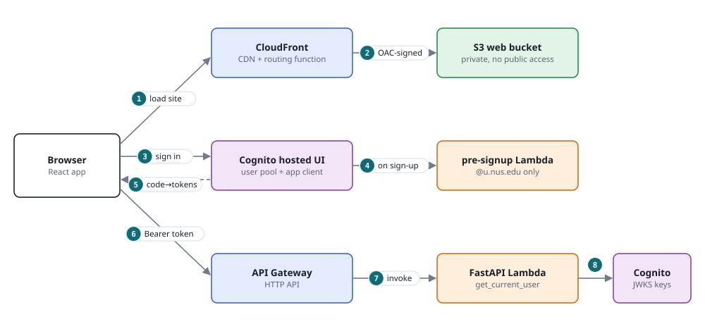
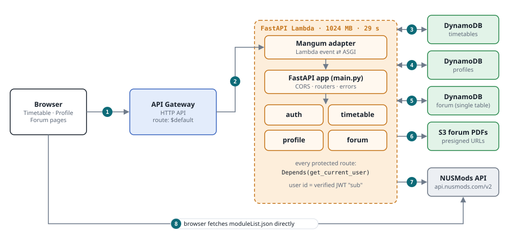
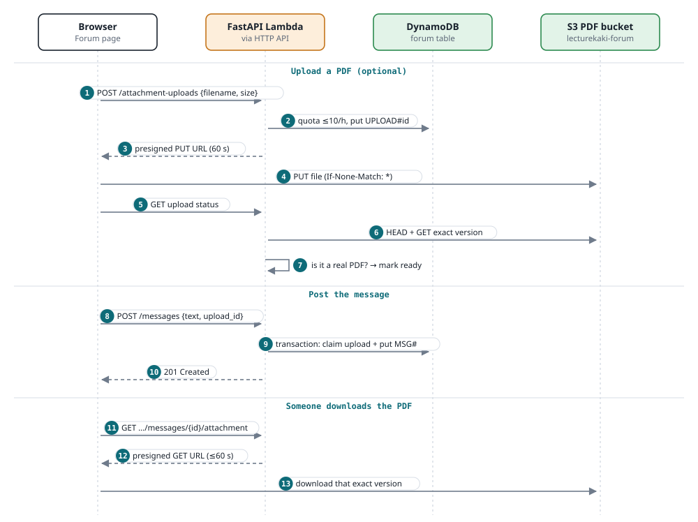
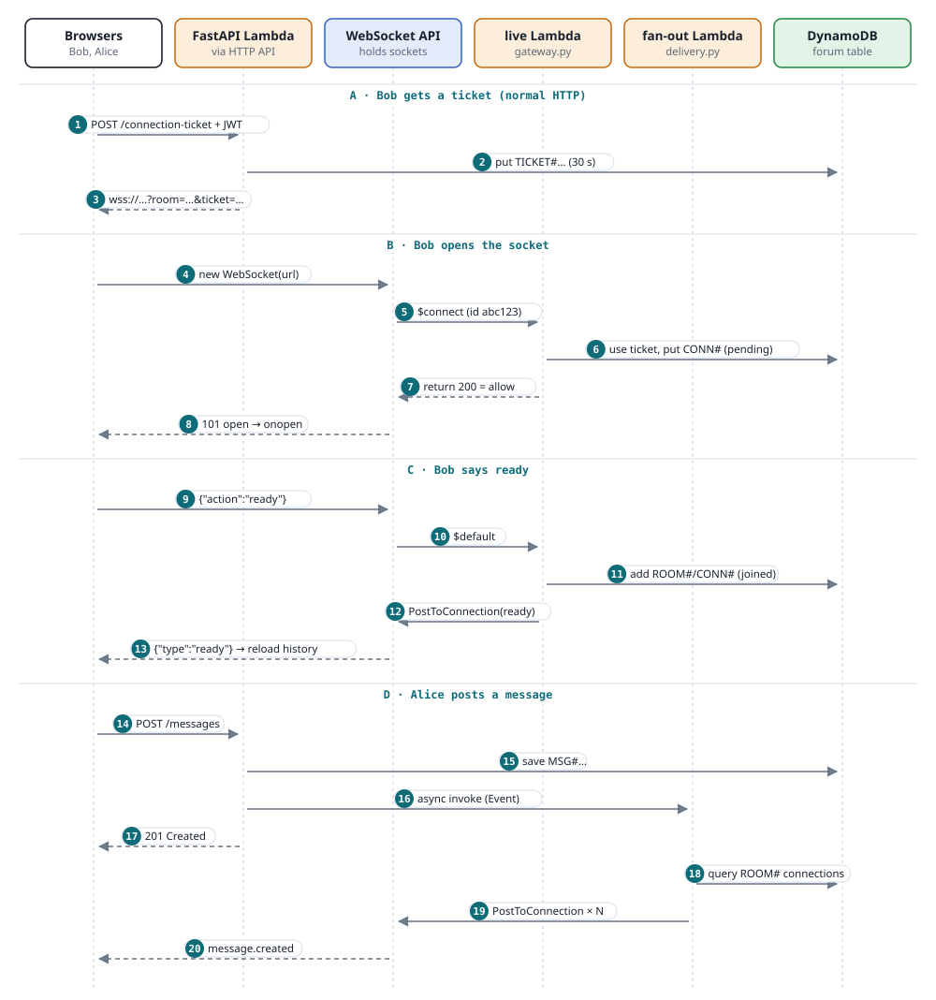
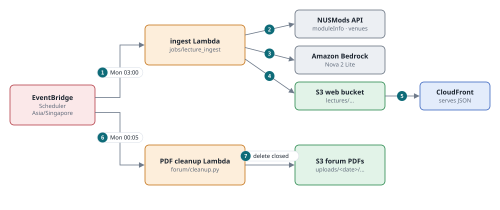
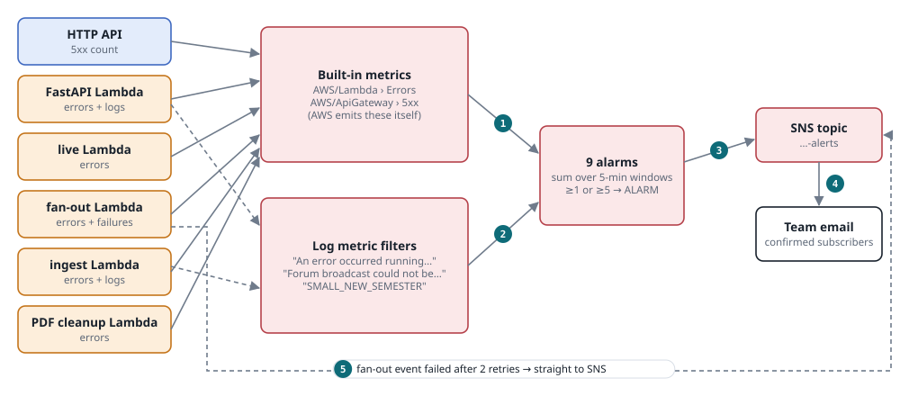

LectureKaki Field Guide

CS5224 · LectureKaki · read-through

# LectureKaki, part by part

The whole system split into six pieces, each with its own diagram. Numbers on the arrows match the numbered steps underneath, so you can follow one request from the browser to the database and back. The file paths point at the code that does each step.

*Part 0*

## The big picture

A React site on CloudFront, a FastAPI backend on Lambda, and a few small Lambdas around it. No server runs all the time.

This is your team's own diagram from `docs/diagrams/architecture.svg`. It's the one the TA is most likely to have seen, so get comfortable reading it first. Every box on it is explained in one of the parts below.


Team diagram, generated by `docs/diagrams/architecture.py` (Python "diagrams" library).

### What happens where, in one table

| Concern                                    | AWS service                              | Our code                               | Part |
|--------------------------------------------|------------------------------------------|----------------------------------------|------|
| Serve the website and lecture data         | CloudFront + private S3                  | `frontend/`, `hosting.tf`              | 1, 5 |
| Sign in (NUS emails only)                  | Cognito + pre-signup Lambda              | `auth.ts`, `lambdas/pre_signup`        | 1    |
| Timetable, profile, forum reads and writes | API Gateway HTTP API → Lambda            | `backend/app` (FastAPI)                | 2, 3 |
| PDF attachments                            | S3 with presigned URLs                   | `forum/attachments.py`                 | 3    |
| Live chat updates                          | API Gateway WebSocket API + 2 Lambdas    | `gateway.py`, `delivery.py`            | 4    |
| Weekly lecture refresh, PDF cleanup        | EventBridge Scheduler → Lambdas, Bedrock | `jobs/lecture_ingest`, `cleanup.py`    | 5    |
| Tell the team when something breaks        | CloudWatch alarms → SNS email            | `api.tf`, `ingest.tf`                  | 6    |
| Build, test, deploy                        | GitHub Actions + Terraform               | `.github/workflows`, `infra/terraform` | 7    |

#### The one idea to hold onto

**Everything is serverless and stateless.** A Lambda runs for one request or event and then stops, remembering nothing. Anything that has to last lives in a managed service: files in S3, records in DynamoDB, open sockets in API Gateway, users in Cognito. That's why it scales by itself, and why you pay only for what is used.

### The Lambda functions

Six functions. The first four are built from the **same zip** (`build/api.zip`) and differ only in which handler in `backend/app/aws_lambda.py` they start.

| Function      | Handler                          | Started by              | Does                                  |
|---------------|----------------------------------|-------------------------|---------------------------------------|
| FastAPI (API) | `http_handler` = `Mangum(app)`   | HTTP API, every request | All REST endpoints                    |
| forum live    | `websocket_handler`              | WebSocket API events    | Checks tickets, tracks connections    |
| fan-out       | `fanout_handler`                 | FastAPI, asynchronously | Pushes an event to everyone in a room |
| PDF cleanup   | `cleanup_handler`                | Scheduler, Mon 00:05    | Deletes closed rooms' PDFs            |
| ingest        | `jobs/lecture_ingest/handler.py` | Scheduler, Mon 03:00    | Builds lecture JSON from NUSMods      |
| pre-signup    | `lambdas/pre_signup/handler.py`  | Cognito, on sign-up     | Rejects non-`@u.nus.edu` emails       |

*Part 1*

## Static site and sign-in

How the page reaches the browser, and how a student proves who they are.



Dashed arrow = a response or redirect coming back.

#### Loading the site

- **\[1\]** **The browser asks CloudFront for the page.** CloudFront is AWS's CDN: copies are cached in edge locations near the user. A small **CloudFront Function** (JavaScript that runs at the edge on every request) rewrites React page paths such as `/forum/…` or `/timetable` to `/index.html`. Without it, refreshing on `/forum` would give a 404, because there's no file called "forum" in S3. Paths under `/assets/` and `/lectures/` pass through unchanged. HTTP is redirected to HTTPS, and AWS's managed security-headers policy is added to every response.
- **\[2\]** **CloudFront fetches from S3 using OAC.** The web bucket blocks all public access. Its bucket policy lets exactly one caller read: the CloudFront service, and only when the request comes from *our* distribution (`AWS:SourceArn` condition). OAC (Origin Access Control) means CloudFront signs each request to S3 with SigV4. So nobody can bypass the CDN and read the bucket directly.

#### Caching, in one sentence each

`assets/*` (built JS/CSS with hashed filenames) are cached for a year as `immutable`, because a new build gets new filenames. `index.html` is `no-cache`, so a deploy shows up immediately. Lecture snapshot files are cached for 1 day as `immutable`, and the `lectures/current.json` pointer is `no-cache` (see Part 5). CloudFront's cache policy has a default TTL of 0, so it follows whatever `Cache-Control` header each S3 object carries.

#### Signing in

- **\[3\]** **The browser redirects to Cognito's hosted login page** using the **authorization code flow with PKCE** (`frontend/src/features/forum/auth.ts`). Before redirecting, the app creates two random values. `code_verifier` stays secret in the tab, and its SHA-256 hash (`code_challenge`, method S256) is sent to Cognito. `state` is also sent and is checked when the browser comes back, which blocks forged login responses (CSRF).
- **\[4\]** **On sign-up, Cognito calls the pre-signup Lambda.** It checks the email against a regex for `…@u.nus.edu`. Any other address raises an error, and Cognito refuses the account. Users also confirm their email with a code.
- **\[5\]** **Cognito redirects back to `/auth/callback?code=…&state=…`.** The app checks that `state` matches, then POSTs the code *plus the original verifier* to Cognito's `/oauth2/token`. Cognito hashes the verifier and compares it with the challenge from step 3. A stolen code is therefore useless without the verifier. It returns an **access token** (15 min), an ID token and a **refresh token** (30 days).
- **\[6\]** **Every API call carries `Authorization: Bearer <access token>`.** Tokens live in `sessionStorage`, so each tab has its own and they're gone when the tab closes. A non-secret cookie only remembers "this browser signed in before", and a `localStorage` value tells other tabs when you log out.
- **\[7\]** **API Gateway invokes the FastAPI Lambda** (details in Part 2).
- **\[8\]** **FastAPI verifies the token itself** (`backend/app/modules/auth/dependencies.py`). It downloads Cognito's public signing keys (JWKS) once and caches them, then checks: algorithm is `RS256` and the signature is valid, not expired, the issuer is our user pool, `client_id` is our app, `token_use` is `access` (an ID token is rejected), and `sub` is present. The `sub` (a stable user ID) becomes the user ID for timetables, topics and message authors. A bad token gets **401**. If keys or configuration are unavailable, it gets **503**.

#### Logging out

The app clears local tokens, asks Cognito to revoke the refresh token (`/oauth2/revoke`) and ends the hosted session. An access token that was already issued stays valid until it expires (at most 15 min), because JWTs are checked offline. That's the usual trade-off with short-lived JWTs.

Files: `infra/terraform/hosting.tf` · `infra/auth.yaml` (Cognito, CloudFormation) · `frontend/src/features/forum/auth.ts` · `backend/app/modules/auth/dependencies.py` · `backend/lambdas/pre_signup/handler.py`

*Part 2*

## REST API and storage

One FastAPI app, packaged into one Lambda, behind one catch-all API Gateway route.



- **\[1\]** **The browser sends an ordinary HTTPS request** to the HTTP API's `execute-api` URL, for example `PUT /timetable/semesters` with the JWT in the header. The browser first checks CORS: FastAPI's `CORSMiddleware` only allows our website origins and the methods GET/POST/PUT/DELETE.
- **\[2\]** **API Gateway has a single route, `$default`, with an `AWS_PROXY` integration.** It doesn't route anything itself. It packs the whole request (method, path, headers, body) into a JSON *event* and invokes the Lambda. Inside the Lambda, **Mangum** turns that event into an ASGI request, FastAPI routes it to the right function, and Mangum turns the response back into JSON that API Gateway sends to the browser. Locally, uvicorn replaces Mangum and the FastAPI code is unchanged. The Lambda has a 29-second timeout because API Gateway gives up at 30.
- **\[3\]** **Timetable** (`modules/timetable`): one DynamoDB item per user (key `user_id` = Cognito `sub`), holding a "book" of four semesters' lesson selections. Saving replaces the whole item, so the last write wins. Endpoints: `GET/PUT /timetable/semesters` (the older `/timetable` routes still work).
- **\[4\]** **Profile** (`modules/profile`): interest topics (an ordered list) and username, stored in the profiles table (also keyed by `user_id`). `PUT /profile/topics` keeps the order and drops duplicates. Signed out, topics live in `localStorage`. On sign-in, browser topics are copied up only if the account has none.
- **\[5\]** **Forum** (`modules/forum`): messages, upload records, tickets and connections all live in one table using the single-table pattern (see [Data model](#data)). Details are in Parts 3 and 4.
- **\[6\]** **PDFs**: the API never streams file bytes to or from the browser. It hands out short-lived **presigned URLs** and only reads the file once, to check it (Part 3).
- **\[7\]** **NUSMods**: when you save a timetable, the backend fetches each module from `api.nusmods.com/v2` and **checks your selections really exist** (right semester, right lesson type and class number). Responses are capped at 5 MB. A user can't save made-up lessons by calling the API directly.
- **\[8\]** **Some data never touches our API.** The Timetable page downloads NUSMods' `moduleList.json` straight from the browser for "Add a module" search, and Discover reads lecture JSON from CloudFront. **Both searches run entirely in the browser.**

### All the REST endpoints

| Method & path                                                  | Auth | What it does                                          |
|----------------------------------------------------------------|------|-------------------------------------------------------|
| `GET /health`                                                  | no   | Returns `status: ok` (used by deploy and smoke tests) |
| `GET /auth/me`                                                 | yes  | Who am I (from the verified token)                    |
| `GET · PUT /timetable/semesters`                               | yes  | Load / save the four-semester book                    |
| `GET · PUT · DELETE /timetable`                                | yes  | Older single-timetable routes                         |
| `GET /profile`, `PUT /profile/topics`, `PUT /profile/username` | yes  | Profile data                                          |
| `GET · POST /rooms/{room}/messages`                            | yes  | Read history (cursor pages, ≤100) / post a message    |
| `DELETE /rooms/{room}/messages/{id}`                           | yes  | Delete your own message                               |
| `POST /rooms/{room}/attachment-uploads`                        | yes  | Start a PDF upload, get a presigned PUT URL           |
| `GET /rooms/{room}/attachment-uploads/{id}`                    | yes  | Check and validate the uploaded PDF                   |
| `GET /rooms/{room}/messages/{id}/attachment`                   | yes  | Get a presigned download URL                          |
| `POST /rooms/{room}/connection-ticket`                         | yes  | Get a one-time WebSocket ticket (Part 4)              |

Interactive docs run at `/docs` (Swagger, generated by FastAPI). Files: `backend/app/main.py` · `backend/app/aws_lambda.py` · `backend/app/modules/*` · `infra/terraform/api.tf` · `storage.tf`

*Part 3*

## Forum: messages and PDF attachments

One room per lecture session. Posting is plain HTTP; PDFs go straight between the browser and S3.

### What a "room" is

Every lecture *session* (one module, one date, one time, one venue) has its own room. The room ID is built from the session ID plus the term:

``` tree
CS2040-LEC-1@2026-11-17-1000-LT19@2026-2027@1
└─ module ─┘ └type┘└class┘ └── date ──┘ └time┘ └venue┘ └acad year┘ └sem┘
```

The browser only shows rooms that exist in the current lecture catalogue. The backend checks the ID's format, date, time and academic year. **A room closes at Sunday 23:59 Singapore time of its lecture's week.** After that, `room_closes_at` in `forum/service.py` makes the API return **403** for reading, posting, uploading and tickets, so a hand-typed URL can't get around the UI.



Read top to bottom. Dashed = response going back. The PDF part is optional; a plain message is just steps 8–10.

#### Uploading a PDF

- **\[1\]** **Ask to upload.** The browser sends the filename (must end in `.pdf`, no slashes or control characters) and the size (1 byte to 15 MB).
- **\[2\]** **Quota and record.** A `PDFQUOTA#<user>#<hour>` counter allows at most **10 uploads per user per hour**; past that, the API returns 429. Then it saves `UPLOAD#<id>` with the room, author, size and the S3 key `uploads/<room's closing date>/<id>.pdf`. The record expires after 10 minutes if it isn't used.
- **\[3\]** **Presigned PUT URL.** The API signs a URL that allows *exactly one thing* for 60 seconds: PUT to that key, with that content type, that exact size, and `If-None-Match: *` (only if the object doesn't already exist).
- **\[4\]** **The browser uploads straight to S3.** The file never passes through Lambda, which keeps Lambda fast and cheap and avoids API Gateway's payload limits. The bucket's CORS rules allow PUT only from our website origins.
- **\[5–7\]** **Check the file.** The browser asks for the upload's status. The API reads the object's metadata (it needs a **version ID**, because the bucket is versioned), then reads that exact version. It checks that the size and type match, the file starts with `%PDF-`, `pypdf` can parse it, it isn't encrypted, and it has 1–1000 pages. Only then is the upload marked *ready* and that version ID recorded. At most 2 checks run at once per Lambda; beyond that it returns "busy, retry" (429).

#### Posting

- **\[8\]** **Post.** Text must be 1–500 characters. The room must be open.
- **\[9\]** **One DynamoDB transaction does two things together:** marks the upload as claimed (only if it belongs to this room and author, has the validated version, hasn't expired and isn't already claimed) *and* writes `ROOM#<room> / MSG#<id>`. Either both happen or neither does, so one PDF can't be attached to two messages. Messages get `expires_at` and `ttl` set to the room's closing time.
- **\[10\]** **201 Created.** Right before replying, FastAPI hands the "new message" event to the fan-out Lambda, covered in Part 4.

#### Downloading

- **\[11–13\]** **Presigned GET.** The API signs a URL for the *exact version* it validated, valid for **60 seconds or until the room closes, whichever is sooner**. It forces a download (`Content-Disposition: attachment`, `application/octet-stream`, `no-store`), so the browser never renders it inline. The browser opens that URL directly.

#### Deleting and expiry

**Delete:** only the author can delete (the API compares the message's author with your token's `sub`; anyone else gets 403). It deletes the message (a conditional delete, so a race returns 404), broadcasts `message.deleted`, then deletes the attached PDF version from S3.

**Expiry:** messages disappear through DynamoDB TTL (eventually; reads already hide them). PDFs are deleted by the Monday cleanup job (Part 5). Reading history uses cursor-based pages of at most 100.

Files: `backend/app/modules/forum/api.py` · `attachments.py` · `attachment_store.py` · `service.py` · `repository.py` · `infra/terraform/forum.tf`

*Part 4*

## Live forum updates

The socket is only used to *receive* updates. All writes still go through HTTP.

#### Read this first

A Lambda can't hold a connection open: it runs and then stops. So **API Gateway's WebSocket API keeps every socket open** and gives each one an ID such as `abc123`. When something happens on a socket (connect, a message, disconnect), API Gateway calls the **live** Lambda briefly. When *we* want to send something to a browser, any Lambda calls API Gateway's `PostToConnection(abc123, data)`. **DynamoDB records which connection IDs are in which room.**



#### A · Get a ticket

- **\[1\]** **Ask for a ticket over HTTP**, with the normal `Authorization: Bearer` JWT. FastAPI checks the token and that the room is open.
- **\[2\]** **Save the ticket.** It's 32 random bytes (`secrets.token_urlsafe`), stored hashed as `TICKET#…` with the room, user and token expiry. It expires in 30 seconds.
- **\[3\]** **Return a ready-to-use URL**: `wss://<id>.execute-api…/live?room=…&ticket=…`.  
  *Why a ticket?* The browser's `new WebSocket(url)` can't set an Authorization header, so login proof has to go in the URL. URLs get logged, so we don't put the 15-minute JWT there. A ticket works **once**, for **30 seconds**, for **one room**, and only for opening a socket.

#### B · Open the socket

- **\[4\]** **`new WebSocket(url)`** sends an HTTP GET with `Upgrade: websocket`. API Gateway *holds* that request and doesn't answer yet.
- **\[5\]** **API Gateway calls the live Lambda with route `$connect`**, passing the new connection ID, the query string and headers.
- **\[6\]** **The live Lambda checks and records.** If the `Origin` isn't our site it returns 403. It **uses up the ticket** with a conditional delete: the delete only succeeds if the ticket exists, matches the room and hasn't expired, so it can never be used twice. If that fails it returns 401. Then it writes `CONN#abc123` = {room, user, token expiry}. This is **pending**: the connection exists but isn't in the room yet.
- **\[7–8\]** **Returning 200 means "allow".** API Gateway then answers the browser with `101 Switching Protocols`, the socket is open, and the browser fires `onopen`. With 401/403/503 the socket never opens, and the browser retries after 1 s, 2 s, 4 s … up to 30 s, each time with a new ticket.

#### C · The ready handshake

- **\[9\]** **Inside `onopen` the browser sends `{"action":"ready"}`** and starts a 10-second timer.
- **\[10–11\]** **API Gateway routes it as `$default`.** The live Lambda runs `activate_connection`, a DynamoDB transaction that checks `CONN#abc123` still exists and adds `ROOM#<room> / CONN#abc123`. **From now on, fan-out will send to Bob.**
- **\[12–13\]** **The Lambda acknowledges** with `PostToConnection` → `{"type":"ready"}`. The browser clears the timer, **reloads history over HTTP**, shows any events that arrived meanwhile (de-duplicated by message ID), and only then shows "connected".

#### Why the extra "ready" step exists (PR \#30)

`$connect` runs *before* API Gateway has finished opening the socket. If the connection were added to the room at step 6 and someone posted right then, `PostToConnection` would fail with `GoneException`. The code treats that as "user left" and would remove Bob, who would then never get live messages. A `ready` message can only arrive over an open socket, so receiving it proves the socket works. Only then is Bob added to the room.

#### D · Someone posts

- **\[14–15\]** **Alice posts over HTTP** and FastAPI saves the message (Part 3). It is now stored safely.
- **\[16\]** **FastAPI hands off delivery** with `lambda.invoke(InvocationType="Event")`. That means "queue this and don't wait": AWS returns 202 immediately and runs the fan-out Lambda separately. If this hand-off fails, the post *still succeeds*; FastAPI logs "Forum broadcast could not be queued", which raises an alarm (Part 6).
- **\[17\]** **Alice gets 201 straight away**, even if the room has 200 people in it.
- **\[18\]** **Fan-out re-reads the message** (skips it if it was deleted or expired in the meantime) and **queries every `ROOM#<room> / CONN#*`**.
- **\[19–20\]** **`PostToConnection` for each connection, 16 at a time.** API Gateway pushes the data down each socket. A connection whose token has expired is closed. `GoneException` means the person left, so their record is deleted. Any other error makes the Lambda fail on purpose, so AWS **retries it twice**. After that, the event goes to SNS and the team gets an email.

### Keeping the socket healthy

| Situation                    | What happens                                                                                                                                  |
|------------------------------|-----------------------------------------------------------------------------------------------------------------------------------------------|
| No traffic for a while       | Browser sends `{"action":"ping"}` every 4 min (API Gateway closes idle sockets after 10 min)                                                  |
| Access token about to expire | Browser closes the socket ~5 s before expiry and reconnects with a fresh token and ticket                                                     |
| Socket open 2 hours          | API Gateway's hard limit; the browser reconnects                                                                                              |
| Tab closed                   | API Gateway calls the live Lambda with `$disconnect`, which deletes the connection records. If that's missed, DynamoDB TTL removes them later |
| Running locally              | No WebSocket API or fan-out: FastAPI serves `/rooms/{id}/live` and an in-memory hub broadcasts (single process only)                          |

#### The rule that makes this safe

**DynamoDB is the source of truth; the socket is a convenience.** If a push is ever lost (for example the Lambda crashes between saving and handing off), the message is still stored, and the browser reloads history every time it (re)connects.

Files: `backend/app/modules/forum/realtime.py` (tickets, local hub) · `gateway.py` (live Lambda, publish) · `delivery.py` (hand-off, fan-out) · `frontend/src/features/forum/forumSocket.ts`

*Part 5*

## Weekly jobs

Lecture data is pre-built once a week into static JSON. A second job deletes old PDFs.



#### Lecture ingestion (Monday 03:00 SGT)

- **\[1\]** **EventBridge Scheduler starts the ingest Lambda** (`cron(0 3 ? * MON *)`, Asia/Singapore). It works out today's semester from the hard-coded academic calendar (AY2026/27), then decides whether a run is due: **Mondays of teaching weeks 1–3, or the first Monday of a month**. Otherwise it logs "skipped". A manual run with `{"date": "…"}` always runs.
- **\[2\]** **Fetch from NUSMods**: `moduleInfo.json` for the year and `venueInformation.json` for the semester, retrying up to 3 times. It keeps only `Lecture` lessons (not tutorials or labs, and no NUS-ISS courses), then expands "Monday, weeks 1–13" into real dates using the calendar (skipping recess week and public holidays), with times in Singapore time.
- **\[3\]** **Topics.** First, keyword rules on the module title. Then **Amazon Bedrock (Nova 2 Lite)** reads each description and suggests extra topics as numbers from a fixed list (numbers use fewer tokens). **A model topic is kept only if one of that topic's keywords appears in the module's title or description**, because a wrong topic is worse than a missing one. There are at most 3 topics per module. Answers are cached in `lectures/topic-cache.json` by model, topic list and module text, so a weekly run only sends new or changed modules.
- **\[4\]** **Publish to S3, but only if something changed.** It builds the whole snapshot in memory and computes one SHA-256 **fingerprint** of all its files (leaving out `generatedAt` and the random folder name). If that matches `contentHash` in the live `current.json`, it writes nothing except a new `checkedAt` time, and the result says `"unchanged": true`. Otherwise it writes a full snapshot folder first, then switches the pointer `lectures/current.json` (explained below). A manual run with `{"force": true}` publishes anyway.
- **\[5\]** **CloudFront serves those JSON files.** Discover loads `current.json`, follows its `path`, and loads the week or day it needs. No API call and no database.

``` tree
lectures/
├── current.json                ← pointer + contentHash + checkedAt, no-cache   (written LAST)
├── topic-cache.json            ← Bedrock answers
└── <snapshot>/                  ← Cache-Control: public, max-age=86400, immutable
    ├── index.json
    ├── modules.json            ← module details + topics
    ├── weeks/<label>.json       ← e.g. week-07.json
    └── days/<yyyy-mm-dd>.json
```

#### Why the pointer pattern

Browsers never see a half-written update. They keep reading the old snapshot until the single small `current.json` changes, and then they see the new one. Snapshot files never change after they're written, so they can be cached hard. **Rollback** = point `current.json` back at an older snapshot.

**Why the fingerprint (PR \#37):** most weekly runs find identical data. Skipping the write means no duplicate snapshot folders, and browsers and CloudFront keep their cached files. `generatedAt` now means "when the data last changed"; Discover shows `checkedAt` ("last checked"), falling back to `generatedAt`. The hash only says *whether* anything changed, not which file.

**Safety checks:** empty data is never published. A re-run of the *same* semester with fewer than half the previous sessions is rejected. A *new* semester that small is published (the old term is over) but logs `SMALL_NEW_SEMESTER`, which raises an alarm.

#### PDF cleanup (Monday 00:05 SGT)

- **\[6\]** **The scheduler starts the cleanup Lambda** five minutes after the week has rolled over.
- **\[7\]** **It lists every version under `uploads/`**. The folder name is the room's closing date, so any folder whose date has passed belongs to closed rooms. It deletes **all versions and delete markers** there, in batches of 1000, including uploads that were never posted. If any delete fails, the Lambda raises an error so the alarm fires. Its IAM role can only list and delete under `uploads/`.

#### Known limits

The calendar only covers AY2026/27; from August 2027 ingestion fails with "No calendar entry…" and the ingest alarm fires. Special terms aren't ingested. Between terms (for AY2026/27, 23 Nov 2026 – 3 Jan 2027) every week is past, so Discover says the term has ended. Semester 2 is published on Monday 4 Jan 2027.

Files: `backend/jobs/lecture_ingest/` (`handler.py`, `nusmods.py`, `academic_calendar.py`, `transform.py`, `topics.py`, `llm_topics.py`, `publish.py`) · `backend/app/modules/forum/cleanup.py` · `infra/terraform/ingest.tf` · `forum_cleanup.tf`

*Part 6*

## Monitoring and alerts

9 CloudWatch alarms, one SNS topic, one email list.



Solid arrows: built-in metrics. Dashed: log lines counted by a filter.

- **\[1\]** **Built-in metrics.** AWS reports Lambda `Errors` for every failed run (exception, timeout, out of memory) and API Gateway `5xx` for every server-error response, without any code from us.
- **\[2\]** **Log metric filters** turn a specific log line into a number, for problems that aren't crashes: a FastAPI crash caught by Mangum, a failed fan-out hand-off, and `SMALL_NEW_SEMESTER`.
- **\[3\]** **Each alarm adds up its metric in 5-minute windows.** When a window reaches the threshold it goes to ALARM and publishes to SNS, **once per change** (not once per error). It returns to OK quietly, and no data counts as OK.
- **\[4\]** **SNS emails every confirmed subscriber.**
- **\[5\]** **A fan-out event that still fails after 2 retries** goes straight to the SNS topic (the Lambda's on-failure destination). This isn't an alarm.

| \#  | Alarm                                 | Fires on (per 5 min)                            |
|-----|---------------------------------------|-------------------------------------------------|
| 1–3 | `…-errors` for FastAPI, live, fan-out | ≥ 5 Lambda errors                               |
| 4   | `…-ingest-errors`                     | ≥ 1 error (weekly job: any failure matters)     |
| 5   | `…-pdf-cleanup-errors`                | ≥ 1 error                                       |
| 6   | `…-5xx` (HTTP API)                    | ≥ 5 server-error responses                      |
| 7   | `…-crashes`                           | log "An error occurred running the application" |
| 8   | `…-fanout-enqueue-errors`             | log "Forum broadcast could not be queued"       |
| 9   | `…-ingest-small-new-semester`         | log "SMALL_NEW_SEMESTER"                        |

Files: `infra/terraform/api.tf` (alarms 1–3, 6–8) · `ingest.tf` (4, 9, SNS topic) · `forum_cleanup.tf` (5)

*Part 7*

## CI/CD and infrastructure

Every PR is tested in Docker. Every merge to main produces a Terraform plan that a human approves.

### On every pull request: `ci.yml`

- **job 1 · Backend checks**: Docker image runs lint, format check and pytest
- **job 2 · Frontend checks**: ESLint, Prettier, TypeScript, Vitest, build
- **job 3 · Infra & containers**: cfn-lint, `terraform fmt/validate`, build images, `compose up`, `smoke_test.py`

### On push to main: `terraform-deploy.yml`

- **1 · Package**: `package_ingest.py` and `package_api.py` build zips with Linux wheels
- **2 · Plan**: `terraform plan`, shown in the run summary
- **3 · Human approval**: GitHub "dev" environment gate
- **4 · Apply**: Updates Lambdas whose zip hash changed
- **5 · Seed data**: Runs ingestion if there's no `current.json` yet
- **6 · Health check**: `GET /health` must say ok
- **7 · Frontend**: Vite build with API/Cognito URLs, `s3 sync`

&nbsp;

- **No AWS keys stored in GitHub.** Actions logs in with **OIDC**: GitHub issues a short-lived identity token, and AWS lets it take on a deployment role (`infra/terraform/github/`).
- Only one deploy runs at a time (`concurrency: terraform-dev`). Terraform state lives in S3 with versioning and locking.
- Backend and frontend are released from the same commit, because both sides implement the ready handshake.

### Who owns which resource

| Resource                                                           | Managed by                                                                    |
|--------------------------------------------------------------------|-------------------------------------------------------------------------------|
| Website, CloudFront, Lambdas, API Gateways, schedules, alarms, SNS | Terraform (`infra/terraform`)                                                 |
| Profiles table                                                     | Terraform (with `prevent_destroy` and deletion protection)                    |
| Forum PDF bucket `lecturekaki-forum`                               | Terraform, adopted from CloudFormation on 9 Nov 2026 with `Retain` + `import` |
| Cognito user pool, client, pre-signup trigger                      | CloudFormation `lecture-kaki-auth-dev` (`infra/auth.yaml`)                    |
| Timetable and forum tables                                         | CloudFormation stacks (Terraform only *reads* them)                           |

#### Running it locally

`docker compose up --build -d --wait` → UI on `localhost:8080` (nginx), API on `localhost:8000/docs` (uvicorn, no Mangum). Containers run read-only with all Linux capabilities dropped. Lecture data comes from `backend/scripts/ingest_local.py`; login and the database need the shared dev settings in `.env.local`.

*Reference*

## Data model

Three DynamoDB tables, all on-demand billing (`PAY_PER_REQUEST`), plus two S3 buckets.

### Forum table: one table, many record types

The table has a generic partition key `PK` and sort key `SK`. Each record type uses a prefix, so one table holds everything, and one query on `PK = ROOM#x` can fetch a room's messages (`SK` begins with `MSG#`) or its connections (`SK` begins with `CONN#`). A `ttl` attribute lets DynamoDB delete old records for free.

| PK                       | SK                    | What                                                                    | Lives until                |
|--------------------------|-----------------------|-------------------------------------------------------------------------|----------------------------|
| `ROOM#<room>`            | `MSG#<id>`            | A message: author `sub`, text, optional attachment {key, version, size} | Room closes                |
| `UPLOAD#<id>`            | `METADATA`            | A PDF upload in progress; becomes `claimed` when posted                 | 10 min                     |
| `PDFQUOTA#<user>#<hour>` | `METADATA`            | Upload counter (max 10/hour)                                            | 2 h                        |
| `TICKET#<hash>`          | `METADATA`            | One-time WebSocket ticket                                               | 30 s, or deleted on use    |
| `CONN#<connectionId>`    | `METADATA`            | A socket, pending until ready                                           | Token expiry or disconnect |
| `ROOM#<room>`            | `CONN#<connectionId>` | "This socket is in this room" (added on ready)                          | Token expiry or disconnect |

### Other storage

| Store            | Key                               | Holds                                                 |
|------------------|-----------------------------------|-------------------------------------------------------|
| Timetables table | `user_id`                         | Four-semester lesson selections                       |
| Profiles table   | `user_id`                         | Ordered topic list, username                          |
| S3 web bucket    | path                              | Built frontend + `lectures/` JSON                     |
| S3 forum PDFs    | `uploads/<closing date>/<id>.pdf` | Versioned, encrypted, TLS-only, public access blocked |

*Rehearsal*

## Questions a TA is likely to ask

Why serverless instead of EC2 or containers?  
Usage is spiky (around lecture times) and low most of the time. Lambda and on-demand DynamoDB cost nothing when idle and scale automatically, and there are no servers to patch. The project used to run on a Caddy server and moved to Lambda.

How does it scale?  
Lambdas keep no state between requests, so AWS runs as many copies as needed. Sockets are held by API Gateway and room membership is in DynamoDB, so any Lambda copy can broadcast. Static content is served from CloudFront's cache. The limits are Lambda concurrency, API Gateway quotas, and fan-out work that grows with room size.

Why is lecture data static JSON and not an API?  
It changes weekly and is identical for everyone. Pre-built files behind a CDN are the fastest and cheapest option and don't touch the backend at all. Search runs in the browser.

What is Mangum?  
An adapter *inside* the FastAPI Lambda. It converts API Gateway's event into an ASGI request for FastAPI and converts the response back. The same app runs under uvicorn locally.

Why a ticket for the WebSocket?  
Browsers can't set headers on `new WebSocket()`, and a JWT in a URL could be logged. A ticket is single-use, lasts 30 s, works for one room, and can only open a socket.

Why the ready handshake?  
`$connect` runs before the socket is fully open. Joining the room only after `ready` means a broadcast can't hit a half-open socket and wrongly remove a user.

Can a message be lost?  
The *message* can't: it's saved before anything else. A live *notification* can be, rarely (a crash between saving and handing off). The client reloads history on every (re)connect, and a failed hand-off raises an alarm.

Why does the browser upload PDFs directly to S3?  
It keeps large bodies out of Lambda and API Gateway (cheaper, no payload limits). The presigned URL is locked to one key, one size, one content type, 60 s, and no overwrite. The server still checks the file before it can be posted.

How is security handled?  
NUS-only sign-up; PKCE login; offline JWT checks (RS256, issuer, client, `token_use`); ownership checks on delete; rooms closed by date on the server; single-use tickets; short presigned URLs; private S3 via OAC; least-privilege IAM role per Lambda; CORS restricted to our origins; OIDC deploys with no stored keys.

How do you know when something breaks?  
9 CloudWatch alarms → SNS → email: Lambda errors, API 5xx, and three log-based checks.

Where is AI used?  
Only in weekly ingestion: Bedrock Nova 2 Lite adds topics, checked against keywords and cached so unchanged modules aren't sent again.

What would you improve?  
Make the academic calendar data-driven instead of hard-coded; move the remaining CloudFormation stacks into Terraform; add a custom domain; load-test fan-out for large rooms.

Built from the `main` branch of CS5224-Lecture-Kaki (last merged PR \#37). Read-only walk-through; nothing in the repo was changed.
